## WebUI

The WebUI is optimized for mobile browsers but looks great on PCs, too.

### Player: Web Mode

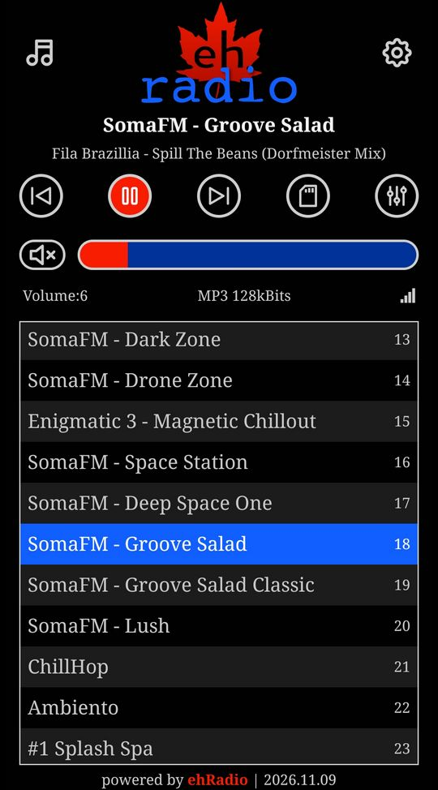

### Playlist Editor

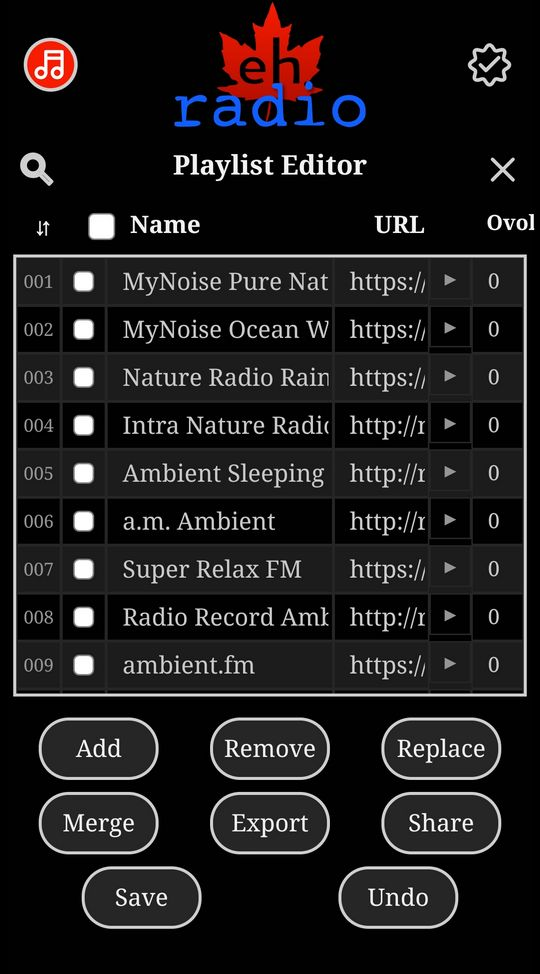

### Playlist Validator

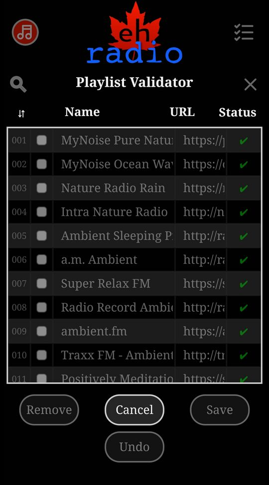

### Search

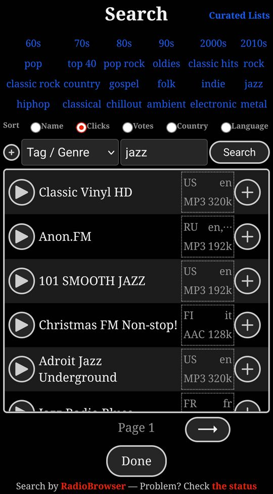

### Curated Lists

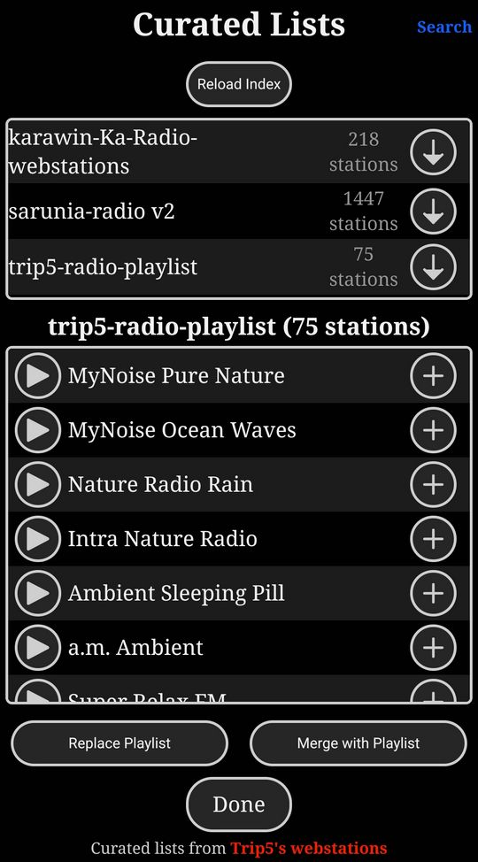

### Player: SD Mode

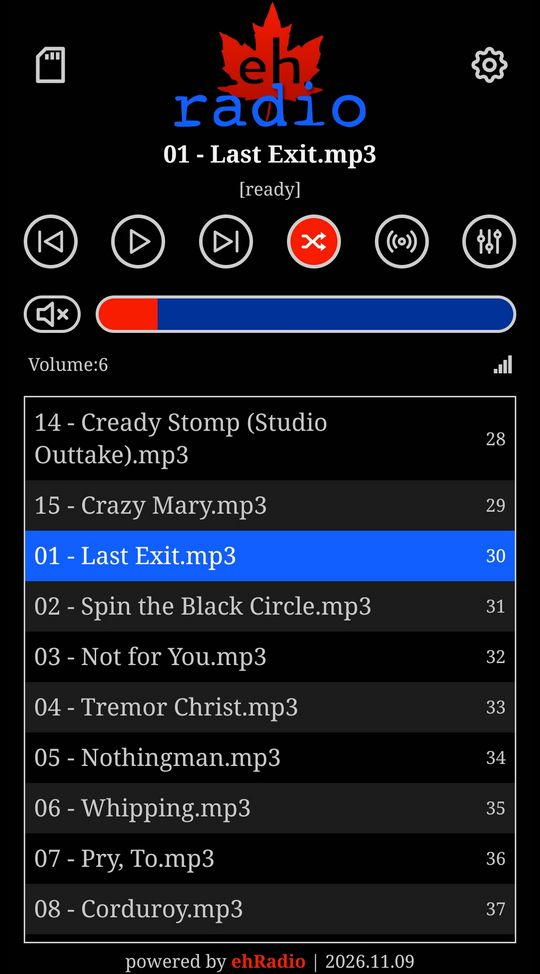

### SD File Manager

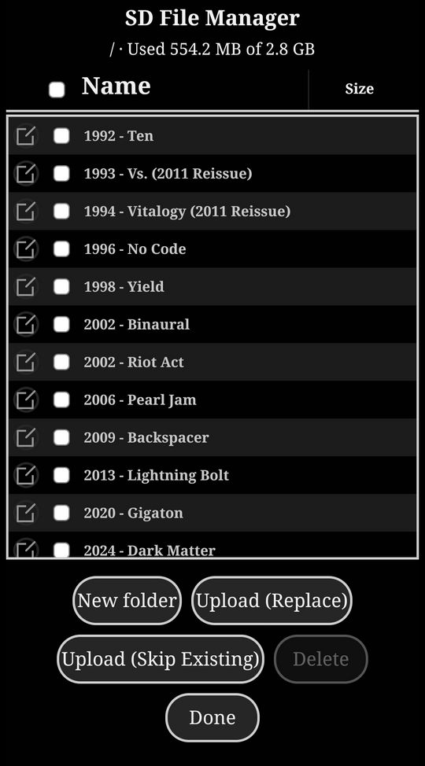

### Settings: Controls

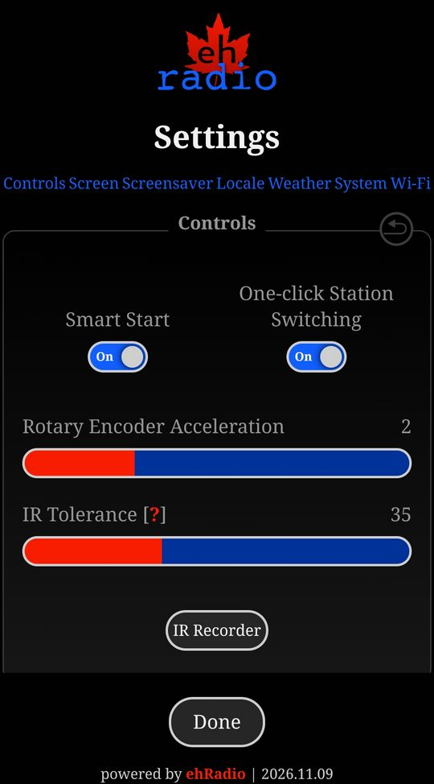

### Settings: Screen

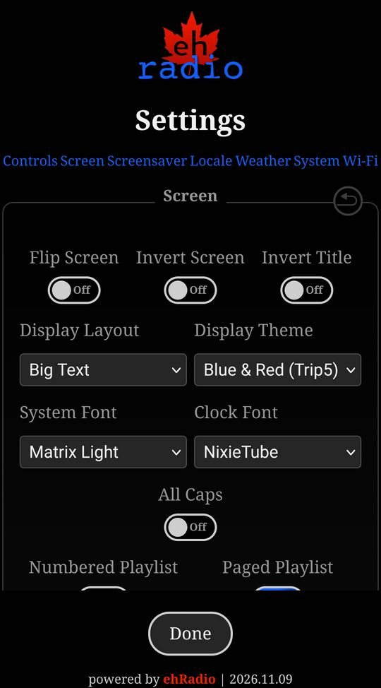

### Settings: Screensaver

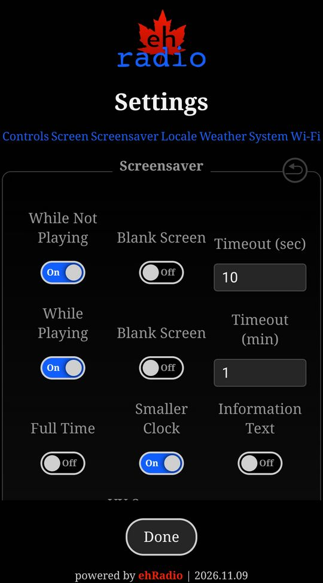

### Settings: Locale

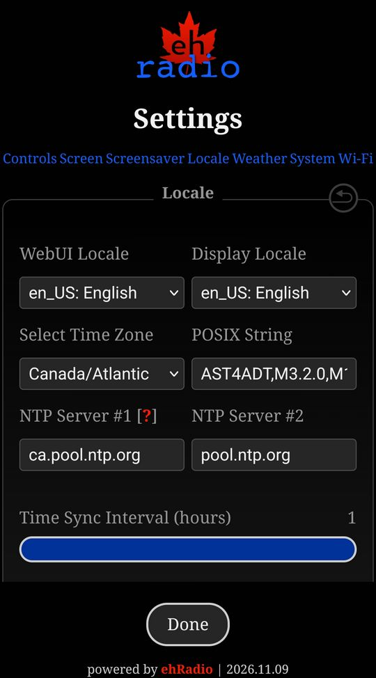

### Settings: Weather

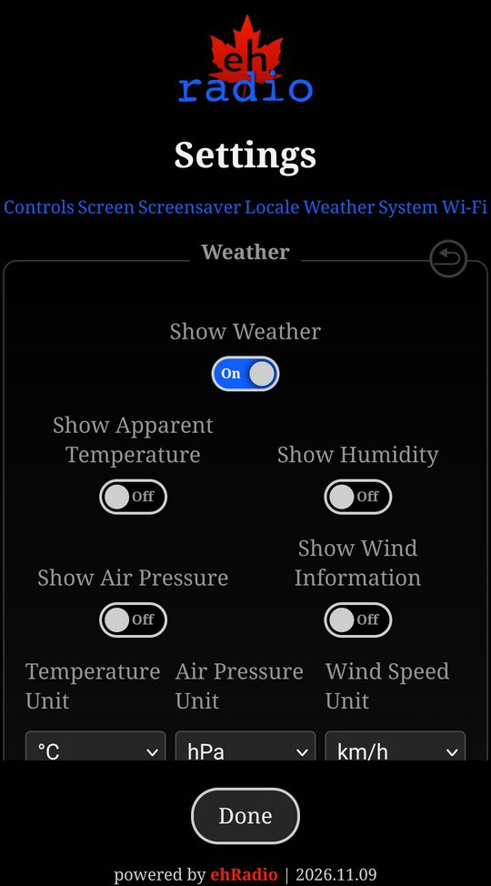
